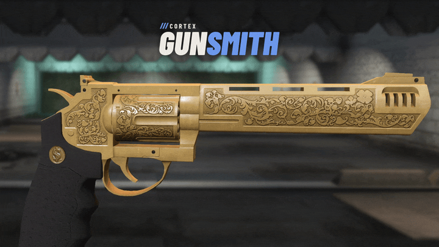

# Cortex Gunsmith

[](https://gsdmods.com/scripts/cortex-gunsmith?utm_source=github&utm_medium=readme&utm_campaign=cortex-gunsmith)

**[Download Latest Release (v1.0.1)](https://github.com/IEver3st/cortex-gunsmith/releases/latest)** · [Product Page](https://gsdmods.com/scripts/cortex-gunsmith?utm_source=github&utm_medium=readme&utm_campaign=cortex-gunsmith) · [All 36 Cortex Scripts](https://gsdmods.com/scripts?utm_source=github&utm_medium=readme&utm_campaign=cortex-gunsmith) · [Docs](https://gsdmods.com/docs?utm_source=github&utm_medium=readme&utm_campaign=cortex-gunsmith) · [Discord](https://discord.com/invite/gsdmods)

> **Free direct download — no Tebex checkout or Asset Escrow required.** Download the ready-to-drop `cortex-gunsmith-1.0.1.zip` from [GitHub Releases](https://github.com/IEver3st/cortex-gunsmith/releases/latest) and extract `cortex-gunsmith` into your FiveM `resources/` folder.

A 3D gunsmith bench for any weapon, no workbench needed. Hold a weapon and press F9: the view drops into first person, you're locked in place, and the weapon leaves your hands to float in front of your eyes on the game's own model, lit, with real depth of field behind it. Turn it with the mouse, zoom in, and pick a slot: every part that fits it is listed beside its own model. The old part slides off along its rail and the new one clicks into place, with the weapon kicking under your hand. Strip it down and every part spreads out along its axis with its name on a tag. Tints and Mk II camo colours change the real finish, and the stat bars show what a part does before you fit it. Fling the weapon and it keeps turning. A fitted flashlight switches on and lights the street. Fire a blank to see the muzzle flash, the smoke and the case fly; a suppressor all but hides the flash. Hold C to see the weapon as it came from the factory, and let go to get your build back. A controller rumbles as each part goes on.

Mid-fight there's no time for a bench, so there's a quick swap as well. Hold its key and the weapon's parts show beside your crosshair. Scroll to one, click to step it to the next part you carry (or take it off), and let go. Everything is fitted at once, and you keep moving and aiming the whole time.

## Requirements

- [Cortex Lib](https://github.com/IEver3st/cortex-lib/releases/latest) 3.4.0 or newer (free)
- OneSync
- Qbox with ox_inventory, or no inventory at all: without one the bench runs standalone and every part is free.
- Experimental: QBCore and ESX (see Items).

## Install

1. Put `cortex-gunsmith` in your resources. Keep the folder name. Start it after Cortex Lib and your inventory:

   ```cfg
   ensure cortex-lib
   ensure ox_inventory
   ensure cortex-gunsmith
   ```

2. Parts are attachment items (see Items). Fitting one takes it from the player's inventory and taking it off gives it back. Standalone servers need no items: every part is free.

Restart the whole server after adding items.

## Items

The bench uses ox_inventory's attachment item names: `at_flashlight`, `at_grip`, `at_barrel`, `at_compensator`, `at_suppressor_light`, `at_suppressor_heavy`, the `at_muzzle_*` brakes, the `at_scope_*` sights, the `at_clip_extended_*` and `at_clip_drum_*` magazines and the `at_skin_*` finishes. ox_inventory ships 61 of the 76. The other 15 are the Mk II rounds (`at_ammo_fmj`, `at_ammo_tracer`, `at_ammo_incendiary`, `at_ammo_hollowpoint`, `at_ammo_armorpiercing`, `at_ammo_explosive`) and nine weapon kits. To use them on ox_inventory, paste `install/ox_inventory.lua` into the `Components` table of `ox_inventory/data/weapons.lua`.

The bench lists every part the game has for the weapon. A part whose item the player doesn't carry shows as not carried and can't be fitted.

If your server calls an item something else, map it:

```lua
Config.items = { at_flashlight = 'weapon_flashlight' }
```

- **ox_inventory**: fitted parts live in the weapon's `components` metadata, so ox_inventory puts them on the weapon whenever it is drawn. The tint goes in `tint` and the camo colour in `gunsmithLivery`.
- **QBCore** (qb-core inventory): parts are stored as `info.attachments` on the weapon item, the format qb-weapons reads, plus `info.tint`. Add the `at_*` items to `qb-core/shared/items.lua`, or map QBCore's own attachment names with `Config.items`.
- **ESX** (without ox_inventory): parts are loadout components and the items come from the ESX inventory. ESX can't store a camo colour, so that slot isn't offered.

QBCore and ESX support is experimental. It follows their documented APIs but hasn't been run on a live QBCore or ESX server yet, so report anything that looks wrong.

### Using an item

With `Config.openOnUse = true`, using a part item while holding a weapon opens the bench on that part's slot. On QBCore and ESX this is registered for every part item automatically. ox_inventory fits component items itself when they are used. To open the bench instead, give the item `server = { export = 'cortex-gunsmith.useItem' }`.

## Use

| Action | Keyboard and mouse | Controller |
| --- | --- | --- |
| Open / close the bench | F9, or `/gunsmith` | Bind under Settings > Key Bindings > FiveM |
| Turn the weapon | Drag (let go mid-drag to fling it) | Right stick |
| Zoom (in on the open part) | Mouse wheel | LT / RT |
| Pick a slot | 1 to 9, click a slot or its keycap | LB / RB, D-pad left / right |
| Browse parts | W / S, arrows, hover | D-pad up / down |
| Fit or take off | Enter, Space or click | A |
| Strip down | X | X |
| Fire a blank | F | Y |
| See it stock (hold) | C | Left stick click |
| Reset the view | R | Right stick click |
| Back / close | Esc or Backspace | B |

The blank is for show: nothing leaves the barrel, and only you see and hear it. The game has no gunshot sound a script can play without firing a real bullet, so you hear the action cycle instead.

### Quick swap

| Action | Keyboard and mouse | Controller |
| --- | --- | --- |
| Show the parts (hold) | Bind under Settings > Key Bindings > FiveM | Bind there too |
| Choose a part slot | Mouse wheel or arrow keys | D-pad up / down |
| Step it to the next part you carry, or off | Left mouse | RT |
| Fit the changes | Let go of the key | Let go |

Quick swap has no default key, because every key near WASD is already taken on most servers. Set one with `Config.quick.key`, or let players bind their own. While the key is held you can't fire, and the weapon wheel is paused. The swap is cancelled if you die, ragdoll, get into a vehicle or water, or change weapons. Finishes and camos stay on the bench.

Players can rebind the open key under Settings > Key Bindings > FiveM. `Config.key` and `Config.padKey` set the defaults. A short controls hint (Cortex Lib, bottom right) shows while the bench is open, with only the keys the screen doesn't already show, and the parts list stops above it.

The bench closes by itself if you get hurt, ragdoll, fall, enter water or a vehicle, or swap weapons. It won't open in a vehicle, in water, while another menu has focus, or when there isn't room in front of you.

### Player settings

Under Cortex settings > Gunsmith, each player chooses:

- **Controls**: show or hide the controls hint.
- **Depth of field**: blur the world behind the weapon. Turn it off on low-end PCs.

With reduced motion in Cortex Lib's presentation settings, the camera cuts straight to the bench and finishes change without the spin.

## Configuration

Everything is in `config.lua`:

- `Config.key`, `Config.padKey`, `Config.command`, `Config.openOnUse`: how the bench opens.
- `Config.quick`: the quick swap's key (none by default), its controller button, or `enabled = false` to remove it.
- `Config.access`, `Config.blockedWeapons`: who may use it (anyone by default) and which weapons it never opens for.
- `Config.inventory`: `'auto'` picks the inventory that is running. Name one (`'ox'`, `'qb'`, `'esx'`, `'standalone'`) to force it.
- `Config.items`: item name mapping.
- `Config.standalone.remember`: without an inventory, remember each player's setup per weapon (by license).
- `Config.tint`: turn tints off, or require an item per change (`item = 'weapontint'`).
- `Config.livery`: Mk II camo colours.
- `Config.bench`: how far the first-person view looks down, field of view, depth of field, the key light and the light on the parts list's models, the pose other players see, turn speed, and switches for the flashlight beam, the blank and controller rumble.
- `Config.sounds`: native sounds for open, browse, fit, take off, finish, the blank, error and close.

`shared/catalog.lua` lists every weapon, part, slot and item. You can edit labels or add a part there. A part without an item can only be fitted on standalone servers.

These files stay readable in the escrowed release: `config.lua`, `locales/*.json`, `shared/locale.lua`, `shared/catalog.lua` and `install/ox_inventory.lua`. The rest of the Lua is encrypted.

### Language

Set `Config.Locale`, or switch without editing files with `setr cortex_gunsmith_locale <code>` in `server.cfg`. Text comes from `locales/<code>.json` (flat keys, `{placeholders}`), and missing keys fall back to English. To add a language, copy `en.json` and translate the values.

## How changes are checked

The server owns every change. Each bench session is tied to the player's weapon item (slot and serial). The server checks that the player still holds it, that the part fits that weapon and slot, and that they carry the part. It applies one change at a time and then re-reads the inventory. If the weapon in the slot has changed, the change is refused and nothing is taken. If writing the weapon fails after the part was taken, the part goes back. If the part coming off no longer fits in the player's pockets, the weapon is put back as it was.

## Exports

Client:

```lua
exports['cortex-gunsmith']:open()     -- open the bench for the weapon in hand
exports['cortex-gunsmith']:close()    -- close it, putting the weapon back
exports['cortex-gunsmith']:isOpen()   -- true while the bench is open
```

Server:

```lua
exports['cortex-gunsmith']:isOpen(source)                 -- true while that player has the bench open
exports['cortex-gunsmith']:useItem(event, item, inventory) -- ox_inventory item callback (see Using an item)
```

## Troubleshooting

- **`You lack the required entitlement`:** the server's license key doesn't belong to the Cfx.re account that claimed Cortex Gunsmith. Claim it with that account, or generate the key on it.
- **`Failed to verify protected resource` or `Error parsing script`:** the encrypted files were damaged on upload. FileZilla in ASCII or auto mode does this. Download it again from the portal and upload in binary mode (or use WinSCP).
- **The bench doesn't open:** hold a weapon first. It won't open in a vehicle, while swimming or falling, or for weapons in `Config.blockedWeapons`. Check the key under Settings > Key Bindings > FiveM.

## License

Free Use License: free to use on servers whose license key belongs to the Cfx.re account that claimed it, including commercial servers. You may edit the readable files listed under Configuration. You may not sell, share or redistribute it. See `LICENSE`.

## More from Cortex

Cortex Gunsmith is free and stays free. All 36 Cortex scripts share one free library ([`cortex-lib`](https://github.com/IEver3st/cortex-lib)) and one consistent UI, with native cross-script integrations and zero conflicts.

### Flagship Paid Suites & Scripts

| Police & Tactical | Economy & World | Core UI & Vehicles |
| --- | --- | --- |
| [**Cortex MDT**](https://gsdmods.com/scripts/cortex-mdt?utm_source=github&utm_medium=readme&utm_campaign=cortex-gunsmith): Full police MDT + Dispatch included free | [**Cortex Banking**](https://gsdmods.com/scripts/cortex-banking?utm_source=github&utm_medium=readme&utm_campaign=cortex-gunsmith): 4 banks, rebuilt 3D ATMs, cards, credit scores & loans | [**Cortex HUD**](https://gsdmods.com/scripts/cortex-hud?utm_source=github&utm_medium=readme&utm_campaign=cortex-gunsmith): HUD Studio with three built-in layouts |
| [**Cortex PolCam**](https://gsdmods.com/scripts/cortex-polcam?utm_source=github&utm_medium=readme&utm_campaign=cortex-gunsmith): FLIR helicopter camera with tracking & ground link | [**Cortex Vending**](https://gsdmods.com/scripts/cortex-vending?utm_source=github&utm_medium=readme&utm_campaign=cortex-gunsmith): Player-owned vending machines with 105 3D products | [**Cortex Handling**](https://gsdmods.com/scripts/cortex-handling?utm_source=github&utm_medium=readme&utm_campaign=cortex-gunsmith): Live in-game vehicle handling editor & exporter |
| [**Cortex Dispatch**](https://gsdmods.com/scripts/cortex-dispatch?utm_source=github&utm_medium=readme&utm_campaign=cortex-gunsmith): Live alerts, unit routing & panic calls | [**Cortex Caseboard**](https://gsdmods.com/scripts/cortex-caseboard?utm_source=github&utm_medium=readme&utm_campaign=cortex-gunsmith): Detective corkboards with red strings & 18 card types | [**Cortex Multicharacter**](https://gsdmods.com/scripts/cortex-multicharacter?utm_source=github&utm_medium=readme&utm_campaign=cortex-gunsmith): Character roster, dossier & ID registration |
| [**Cortex Radar**](https://gsdmods.com/scripts/cortex-radar?utm_source=github&utm_medium=readme&utm_campaign=cortex-gunsmith): Handheld 3D police radar gun | [**Cortex Whiteboard**](https://gsdmods.com/scripts/cortex-whiteboard?utm_source=github&utm_medium=readme&utm_campaign=cortex-gunsmith): 28 drawable boards with city maps & physics | [**Cortex Rewind**](https://gsdmods.com/scripts/cortex-rewind?utm_source=github&utm_medium=readme&utm_campaign=cortex-gunsmith): Forza-style vehicle rewind in FiveM |
| [**Cortex Arges**](https://gsdmods.com/scripts/cortex-arges?utm_source=github&utm_medium=readme&utm_campaign=cortex-gunsmith) · [**Radio**](https://gsdmods.com/scripts/cortex-radio?utm_source=github&utm_medium=readme&utm_campaign=cortex-gunsmith) · [**SceneKit**](https://gsdmods.com/scripts/cortex-scenekit?utm_source=github&utm_medium=readme&utm_campaign=cortex-gunsmith) | [**Cortex Computer**](https://gsdmods.com/scripts/cortex-computer?utm_source=github&utm_medium=readme&utm_campaign=cortex-gunsmith): In-world playable computers & monitors | [**Cortex Chat**](https://gsdmods.com/scripts/cortex-chat?utm_source=github&utm_medium=readme&utm_campaign=cortex-gunsmith) · [**Spawn**](https://gsdmods.com/scripts/cortex-spawn?utm_source=github&utm_medium=readme&utm_campaign=cortex-gunsmith) · [**Emote Studio**](https://gsdmods.com/scripts/cortex-emote-studio?utm_source=github&utm_medium=readme&utm_campaign=cortex-gunsmith) |

### Save with Bundles (One-Time or All-Access)

- [**Cortex Complete**](https://gsdmods.com/scripts/cortex-complete?utm_source=github&utm_medium=readme&utm_campaign=cortex-gunsmith) — One-time lifetime bundle, no subscription.
- [**Cortex LEO Kit**](https://gsdmods.com/scripts/cortex-leo-kit?utm_source=github&utm_medium=readme&utm_campaign=cortex-gunsmith) — Complete unified police stack (`MDT`, `Dispatch`, `PolCam`, `Radar`, `ALPR`, `Arges`, `Radio`, `SceneKit`, `Caseboard`, `Whiteboard`, `Flashlight`, `Binoculars`).
- [**Cortex Interface Kit**](https://gsdmods.com/scripts/cortex-interface-kit?utm_source=github&utm_medium=readme&utm_campaign=cortex-gunsmith) — Complete core UI stack (`HUD`, `Chat`, `Spawn`, `Multicharacter`, `Loading Screen`).
- [**Cortex All-Access**](https://gsdmods.com/scripts/cortex-all-access?utm_source=github&utm_medium=readme&utm_campaign=cortex-gunsmith) — Every current paid script + every future release on day one.

### All Free Cortex Scripts on GitHub

[`cortex-pause`](https://github.com/IEver3st/cortex-pause) · [`cortex-alpr`](https://github.com/IEver3st/cortex-alpr) · [`cortex-newspaper`](https://github.com/IEver3st/cortex-newspaper) · [`cortex-gunsmith`](https://github.com/IEver3st/cortex-gunsmith) · [`cortex-echo`](https://github.com/IEver3st/cortex-echo) · [`cortex-drone`](https://github.com/IEver3st/cortex-drone) · [`cortex-droneraces`](https://github.com/IEver3st/cortex-droneraces) · [`cortex-thrusters`](https://github.com/IEver3st/cortex-thrusters) · [`cortex-megaphone`](https://github.com/IEver3st/cortex-megaphone) · [`cortex-minigames`](https://github.com/IEver3st/cortex-minigames) · [`cortex-admin`](https://github.com/IEver3st/cortex-admin-releases) · [`cortex-atmrobbery`](https://github.com/IEver3st/cortex-atmrobbery) · [`cortex-vendrobbery`](https://github.com/IEver3st/cortex-vendrobbery) · [`cortex-lib`](https://github.com/IEver3st/cortex-lib)
